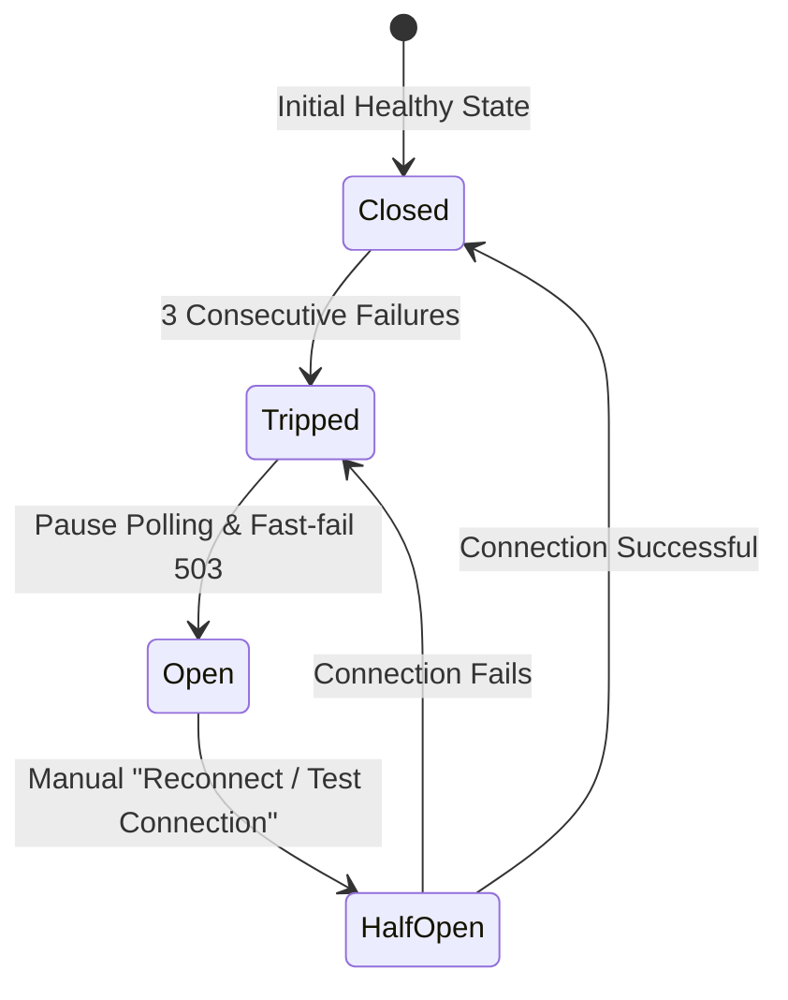

# TikPulse Architecture & Engineering Principles 🏛️

TikPulse is engineered using strict **Clean Architecture**, **Layered Isolation**, and **Resource Zero-Waste** design patterns. This document details the technical decisions and design standards implemented across the stack.

---

## 🏗️ 1. Clean Architecture (Backend Layers)

The backend strictly separates business rules from infrastructure, transport protocols, and frameworks.

```text
app/
├── Domain/              # Enterprise Business Rules (Entities, Enums, Contracts, Value Objects)
│   ├── SafeMode/        # Safe Mode Policies, Action Enums, Guard contracts
│   ├── Router/          # Router domain entities, status enums, circuit breaker definitions
│   ├── Hotspot/         # Voucher value objects, profile specifications, batch entities
│   └── Ppp/             # Subscriber secret contracts, bandwidth profiles, active sessions
│
├── Application/         # Application Business Rules (Use Cases, DTOs, Orchestration Services)
│   ├── Services/        # MikrotikConnectionService, VoucherService, DedicatedUserService
│   └── DTOs/            # Typed Data Transfer Objects between layers
│
├── Infrastructure/      # Frameworks & Drivers (MikroTik Socket, REST API, Database Repositories)
│   ├── Mikrotik/        # SocketRouterOsDriver (Port 8728/8729), RestRouterOsDriver (RouterOS v7)
│   └── Repositories/    # Eloquent persistence implementations
│
├── Models/              # Eloquent Models (User, Group, Module, GroupModulePermission, Router, etc.)
│
└── Http/                # Interface Adapters (Presentation Layer)
    ├── Controllers/     # Thin controllers dispatching requests to Application services
    │   ├── Api/Auth/    # AuthController (Login, Logout, Me, Settings, Switch-Role)
    │   ├── Api/User/    # UserController, GroupController, ModuleController
    │   ├── Api/Router/  # RouterController (Fleet, Telemetry, Reboot, Connectivity)
    │   ├── Api/Hotspot/ # VoucherController, HotspotProfileController, ActiveUserController
    │   ├── Api/Ppp/     # DedicatedUserController, PppProfileController, PppActiveController
    │   └── Api/SafeMode/# SafeModeController (Unlock, Lock, Toggle, AuditLogs)
    ├── Middleware/      # AuthorizeModuleAccess, ResolveRouterContext, EnsureSafeModeCompliance, HandleInertiaRequests
    ├── Requests/        # Validated FormRequests
    └── Resources/       # Eloquent API Resources (UserResource, GroupResource, ModuleResource, etc.)

resources/js/            # Client Presentation Layer (Inertia.js v3 + Svelte 5)
├── Pages/               # Svelte 5 Page components (auth, dashboard, hotspot, ppp, routers, safe-mode, user)
├── components/          # Modular UI components (DataTable, Modals, Forms, Layout, Charts)
│   ├── layout/          # AdminLayout, AppHeader, AppSidebar, SimulationBanner, PreferencesModal
│   └── ui/              # SvelteForge UI Primitives (sidebar, card, button, badge, breadcrumb, avatar, input)
├── stores/              # Svelte 5 reactive stores (.svelte.ts) with localStorage persistence
├── locales/             # Bilingual dictionaries (en.ts, id.ts)
└── types/               # Strict TypeScript definitions & API DTO interfaces
```

### Strict Isolation Rules
- **No Socket Logic in Controllers**: Controllers never open raw network sockets or query `/system/resource` directly. All network interaction is mediated through Application services and Infrastructure drivers.
- **Strict Typing Everywhere**: All PHP files require `declare(strict_types=1);` and full type hints on all parameters and return types.
- **DTO Flow**: Controllers pass validated DTOs to the service layer, keeping domain logic testable without mocking HTTP requests.

---

## 👥 2. Enterprise RBAC & Router Scoping Architecture

TikPulse incorporates a granular Role-Based Access Control (RBAC) engine designed for ISP operators, multi-tenant managers, and branch administrators.

### A. Granular Module Permissions
Permissions are structured across seven core functional modules:
1. `dashboard` — Real-time telemetry, WAN traffic visualizer, active hotspot stats.
2. `routers` — Hardware profiles, connection credentials, reboot commands.
3. `hotspot_vouchers` — Hotspot profiles, voucher generation, print engine, active users.
4. `ppp_subscribers` — PPP bandwidth profiles, subscriber secrets, kick disconnection.
5. `safe_mode_logs` — Hardware guardrail audit logs.
6. `users` — Administrator and operator accounts.
7. `groups` — Access roles and permission matrix definitions.

Each module supports four discrete CRUD actions: `read`, `write`, `update`, and `delete`. The `AuthorizeModuleAccess` middleware (`module.access:<module>,<ability>`) validates each HTTP request and returns **HTTP 403 Forbidden** if the user's group lacks the requested ability.

### B. Group-Based Router Scoping
- Groups can be flagged as `all_routers = true` (granting access to all routers in the fleet) or scoped to specific router IDs via the `group_router` pivot table.
- When an operator makes a request with `X-Router-ID`, the `ResolveRouterContext` middleware validates whether the requested router ID exists within the user's `allowed_router_ids`. If unauthorized, the request is immediately rejected with HTTP 403.

### C. Double-Layer Destructive Guardrail
Destructive commands (such as rebooting hardware or deleting voucher batches) must pass **both** authorization layers:
1. **Layer 1 (RBAC)**: User's group must possess the necessary capability (`update` for reboot; `delete` for bulk purge).
2. **Layer 2 (Safe Mode)**: Target router's `EnsureSafeModeCompliance` middleware checks for an active 15-minute bypass token (`X-SafeMode-Bypass`).

### D. Superadmin Role Simulation
Super Administrators can simulate any operator group via `POST /api/v1/auth/switch-role`:
- The backend sets `simulated_group_id` on the authenticated user record.
- Eloquent dynamic accessors (`$user->effective_permissions` and `$user->allowed_router_ids`) resolve permissions from the simulated group rather than superadmin privileges.
- A persistent `SimulationBanner.svelte` appears at the top of the frontend SPA, allowing one-click reversion back to Super Administrator via `POST /api/v1/auth/reset-role`.

---

## ⚡ 3. Resource Efficiency & Zero-Waste Architecture

Managing fleets of hardware routers requires strict controls over server and network utilization. TikPulse implements multiple defense layers:

### A. Short-Lived Transient Caching (2-3 Seconds)
Polling high-frequency endpoints (e.g. live CPU load, free memory, active hotspot users, and traffic throughput) at scale can exhaust MikroTik CPU and TCP socket buffers.
- TikPulse caches responses in a fast transient cache for **2 to 3 seconds**.
- Multiple frontend consumers or concurrent tabs receive cached data instead of triggering redundant MikroTik queries.

### B. Throttled Database Writes (30s Interval)
- Router status and telemetry timestamps are only committed to PostgreSQL if the connection state changes (e.g. `online` to `offline`) or if the telemetry write interval exceeds **30 seconds**.
- Eliminates thousands of unnecessary database `UPDATE` queries per hour.

### C. Client-Side Page Visibility API
- The frontend integrates the HTML5 Page Visibility API (`pageVisibility.svelte.ts`).
- When a user minimizes the browser or navigates to another tab, **all polling intervals and Chart.js streams automatically pause**.
- When the tab is refocused, polling instantly resumes with a fresh telemetry fetch.
- Saves up to **85%** of idle client and server background resources.

### D. Hardware-Accelerated Canvas Charting
- Real-time WAN traffic visualizers use **Chart.js** over HTML5 `<canvas>` with `animation: false`.
- Eliminates CPU lag and memory leaks typically caused by continuous SVG polygon string calculations.

---

## 🔌 4. Offline Circuit Breaker Architecture

To prevent server thread starvation from connection timeout loops when a router goes offline:



1. **Failure Threshold**: If a router fails to respond within the socket timeout (default 5s) for **3 consecutive attempts**, the Circuit Breaker trips.
2. **Fast-Fail (HTTP 503)**: Any subsequent requests for that router immediately return HTTP 503 without initiating new TCP handshakes.
3. **Manual Recovery**: Administrators can trigger a manual reset via `POST /api/v1/routers/{id}/test-connection` or the "Reconnect" button in the UI.

---

## 🎨 5. SvelteForge Admin UI/UX Architecture

The frontend is built on [SvelteForge Admin](https://github.com/ColorlibHQ/svelteforge-admin) architecture:

1. **Svelte 5 Runes**: Built entirely with Svelte 5 modern reactivity (`$state`, `$derived`, `$props`, `$effect`, and snippets).
2. **Pure UI Primitives**: Modular components in `resources/js/components/ui/` (`Sidebar`, `Card`, `Button`, `Badge`, `Breadcrumb`, `Separator`, `Input`, `Label`, `Avatar`).
3. **Responsive App Layout**:
   - `AppSidebar.svelte`: Categorized navigation grouped by domain, live router status pill, and collapsible drawer with keyboard shortcut (`Ctrl+B`).
   - `AppHeader.svelte`: Interactive breadcrumbs, sidebar trigger, and user profile dropdown.
   - `SimulationBanner.svelte`: Top bar displayed when superadmin is previewing an operator role.
4. **Resilient State Hydration**:
   - `HandleInertiaRequests` middleware shares authenticated user DTOs (`UserResource`) and router fleets (`RouterResource`).
   - `authStore` synchronous hydration with `localStorage` fallback prevents layout shift and UI flickering on hard browser reload (`Ctrl + F5`).
5. **Theme & Customization**:
   - Dark, Light, and System theme modes supported via CSS class toggling on `document.documentElement`.
   - 6 user-selectable theme accent colors (`sky`, `indigo`, `emerald`, `violet`, `amber`, `rose`).
   - Preference persistence synchronized to `users.settings` in PostgreSQL via `PreferencesModal.svelte`.
