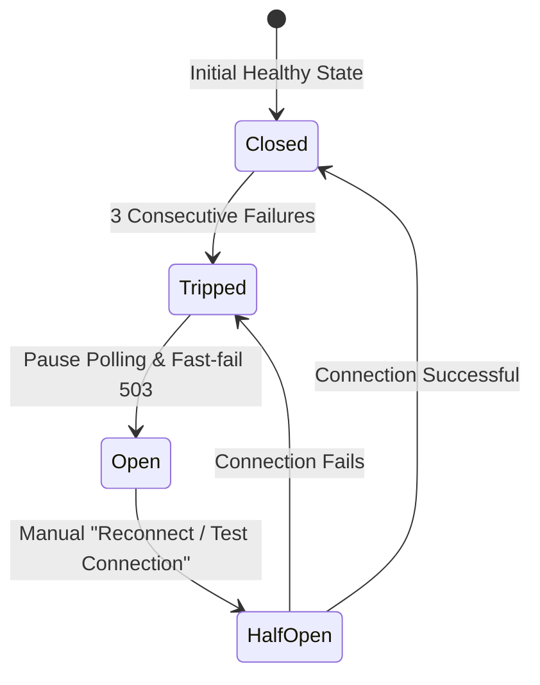

# TikPulse Architecture & Engineering Principles 🏛️

TikPulse is engineered using strict **Clean Architecture**, **Layered Isolation**, and **Resource Zero-Waste** design patterns. This document details the technical decisions and design standards implemented across the stack.

---

## 🏗️ 1. Clean Architecture (Backend Layers)

The backend strictly separates business rules from infrastructure, transport protocols, and frameworks.

```text
app/
├── Domain/              # Enterprise Business Rules (Entities, Enums, Contracts, Value Objects)
│   ├── SafeMode/        # Safe Mode Policies, Action Enums, Guard contracts
│   ├── Router/          # Router domain entities, status enums, circuit breaker definitions
│   ├── Hotspot/         # Voucher value objects, profile specifications, batch entities
│   └── Ppp/             # Subscriber secret contracts, bandwidth profiles, active sessions
│
├── Application/         # Application Business Rules (Use Cases, DTOs, Orchestration Services)
│   ├── Services/        # MikrotikConnectionService, VoucherService, DedicatedUserService
│   └── DTOs/            # Typed Data Transfer Objects between layers
│
├── Infrastructure/      # Frameworks & Drivers (MikroTik Socket, REST API, Database Repositories)
│   ├── Mikrotik/        # SocketRouterOsDriver (Port 8728/8729), RestRouterOsDriver (RouterOS v7)
│   └── Repositories/    # Eloquent persistence implementations
│
└── Http/                # Interface Adapters (Presentation Layer)
    ├── Controllers/     # Thin controllers dispatching requests to Application services
    ├── Middleware/      # ResolveRouterContext, EnsureSafeModeCompliance, HandleInertiaRequests
    ├── Requests/        # Validated FormRequests
    └── Resources/       # Eloquent API Resources

resources/js/            # Client Presentation Layer (Inertia.js v3 + Svelte 5)
├── Pages/               # Svelte 5 Page components (auth, dashboard, hotspot, ppp, routers, safe-mode)
├── components/          # Modular UI components (DataTable, Modals, Forms, Layout, Charts)
├── stores/              # Svelte 5 reactive stores (.svelte.ts) with localStorage persistence
└── types/               # Strict TypeScript definitions & API DTO interfaces
```

### Strict Isolation Rules
- **No Socket Logic in Controllers**: Controllers never open raw network sockets or query `/system/resource` directly. All network interaction is mediated through Application services and Infrastructure drivers.
- **Strict Typing Everywhere**: All PHP files require `declare(strict_types=1);` and full type hints on all parameters and return types.
- **DTO Flow**: Controllers pass validated DTOs to the service layer, keeping domain logic testable without mocking HTTP requests.

---

## ⚡ 2. Resource Efficiency & Zero-Waste Architecture

Managing fleets of hardware routers requires strict controls over server and network utilization. TikPulse implements multiple defense layers:

### A. Short-Lived Transient Caching (2-3 Seconds)
Polling high-frequency endpoints (e.g. live CPU load, free memory, active hotspot users, and traffic throughput) at scale can exhaust MikroTik CPU and TCP socket buffers.
- TikPulse caches responses in a fast transient cache for **2 to 3 seconds**.
- Multiple frontend consumers or concurrent tabs receive cached data instead of triggering redundant MikroTik queries.

### B. Throttled Database Writes (30s Interval)
- Router status and telemetry timestamps are only committed to PostgreSQL if the connection state changes (e.g. `online` to `offline`) or if the telemetry write interval exceeds **30 seconds**.
- Eliminates thousands of unnecessary database `UPDATE` queries per hour.

### C. Client-Side Page Visibility API
- The frontend integrates the HTML5 Page Visibility API (`pageVisibility.svelte.ts`).
- When a user minimizes the browser or navigates to another tab, **all polling intervals and Chart.js streams automatically pause**.
- When the tab is refocused, polling instantly resumes with a fresh telemetry fetch.
- Saves up to **85%** of idle client and server background resources.

### D. Hardware-Accelerated Canvas Charting
- Real-time WAN traffic visualizers use **Chart.js** over HTML5 `<canvas>` with `animation: false`.
- Eliminates CPU lag and memory leaks typically caused by continuous SVG polygon string calculations.

---

## 🔌 3. Offline Circuit Breaker Architecture

To prevent server thread starvation from connection timeout loops when a router goes offline:



1. **Failure Threshold**: If a router fails to respond within the socket timeout (default 5s) for **3 consecutive attempts**, the Circuit Breaker trips.
2. **Fast-Fail (HTTP 503)**: Any subsequent requests for that router immediately return HTTP 503 without initiating new TCP handshakes.
3. **Manual Recovery**: Administrators can trigger a manual reset via `POST /api/v1/routers/{id}/test-connection` or the "Reconnect" button in the UI.

---

## 🌐 4. Multi-Router Context Architecture

Every MikroTik request is scoped by router context:
- The frontend includes the `X-Router-ID` header in API requests.
- The `ResolveRouterContext` middleware retrieves the router model and ensures the user has authorization to access it.
- Credentials stored in `routers.password_encrypted` are decrypted on-the-fly inside `MikrotikConnectionService` using Laravel's AES-256 encrypter.

---

## 🎨 5. UI/UX Uniformity Standards

All pages follow a standardized visual blueprint:
1. **Page Header**: Studio Category Pill Badge (`text-sky-600 bg-sky-500/10`) + Active Router indicator + `h2 font-black` title.
2. **Action Bar**: Primary gradient CTA (`from-sky-600 to-indigo-600`) and border-styled refresh buttons.
3. **Navigation Tabs**: Underline tabs with count badges (`border-b-2 border-sky-500`).
4. **Metric Cards**: 4-column summary metric cards with soft-tinted icon containers.
5. **Data Tables**: Reusable `DataTable.svelte` with custom snippet cells, debounced search, status badges, pagination, and empty states.
6. **Theme**: Fully integrated Dark & Light modes with semantic Tailwind design tokens.
