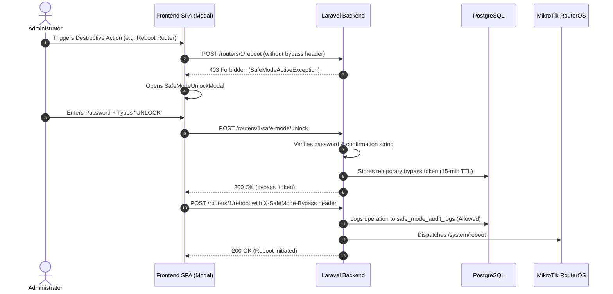

# TikPulse Safe Mode & Hardware Guardrails 🛡️

In high-concurrency ISP, enterprise, and hospitality environments, an inadvertent click on a reboot button, bulk delete action, or config reset can cause catastrophic network downtime. 

TikPulse solves this by enforcing **Hardware Safe Mode Guardrails** (`is_safe_mode_enabled = true` by default) at both the backend middleware and application domain layers.

---

## 🚫 Guarded Destructive Actions

The following operations are strictly intercepted by `EnsureSafeModeCompliance` and `MikrotikSafeModeGuard`:

1. **Hardware Disruption**:
   - Router Reboot (`/system/reboot`)
   - Router Shutdown (`/system/shutdown`)
   - Configuration Reset (`/system/reset-configuration`)
2. **Firmware & Packages**:
   - RouterOS package installation/downgrade (`/system/package/update/*`)
3. **Data Purges & Deletions**:
   - Deleting a router profile from fleet
   - Batch deletion of hotspot vouchers (`bulk_delete_vouchers`)
   - Deleting hotspot user profiles (`delete_hotspot_profile`)
   - Deleting PPP subscriber secrets (`bulk_delete_ppp_secrets`)
   - Deleting PPP profiles (`bulk_delete_ppp_profiles`)

---

## 🔑 Two-Step Unlock Sequence

When Safe Mode is active, destructive actions return **HTTP 403 Forbidden** (`SafeModeActiveException`). To authorize an action:

### Step 1: Administrator Password Verification
The user must provide their account password to confirm identity.

### Step 2: Textual Confirmation String
The user must type the literal string `"UNLOCK"` into the confirmation prompt to ensure deliberate intent.

### Step 3: Temporary Bypass Token (15-Minute TTL)
- Upon successful verification, the API issues a cryptographically secure bypass token valid for exactly **15 minutes**.
- The frontend stores the token in memory (`safeModeStore.ts`) and sends it via the `X-SafeMode-Bypass` HTTP header on subsequent guarded requests.
- When the 15 minutes expire, the router automatically re-locks.
- Administrators can also manually re-lock at any time via `POST /routers/{id}/safe-mode/lock`.

---

## 📋 Audit Trail (`safe_mode_audit_logs`)

Every attempt to execute a guarded operation—whether permitted via token or blocked—is recorded in the `safe_mode_audit_logs` table:

| Column | Type | Description |
|---|---|---|
| `id` | `BIGSERIAL` | Primary Key |
| `router_id` | `BIGINT` | Target Router Profile |
| `user_id` | `BIGINT` | User initiating the action |
| `action` | `VARCHAR(100)` | Name of the guarded action |
| `status` | `VARCHAR(30)` | `'allowed'`, `'blocked'`, or `'failed'` |
| `ip_address` | `VARCHAR(45)` | Client IP address |
| `user_agent` | `TEXT` | Client User-Agent |
| `metadata` | `JSONB` | Parameters and payload details |
| `created_at` | `TIMESTAMP` | Timestamp of event |

Audit logs can be reviewed in real-time from the **Safe Mode Audit Logs** tab in the UI or via `GET /api/v1/routers/{id}/safe-mode/audit-logs`.
